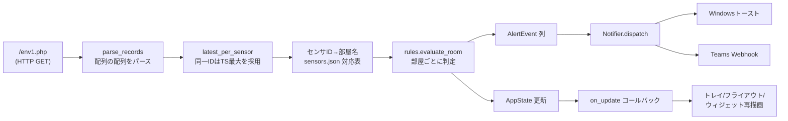

# アーキテクチャ解説（開発者向け）

このドキュメントは **EnvMonitor のコードを読み始める開発者** 向けに、全体像・データフロー・
スレッドモデル・状態管理をまとめたものです。インストールや使い方は
[`README.md`](../README.md)、ビルド・配布は [`BUILD.md`](../BUILD.md) を参照してください。
モジュール単位の責務・主要シンボルは [`MODULES.md`](MODULES.md) にあります。

---

## 全体像

EnvMonitor は 2 つの Python パッケージで構成されます。

| パッケージ | 役割 |
|---|---|
| `envmon/` | アプリ本体。トレイ常駐・環境監視・通知・各 UI。 |
| `taskwidget/` | タスクバー追従ウィジェットの汎用ライブラリ（アプリ非依存）。 |

アプリとしての性格：

- **トレイ常駐アプリ**。メインウィンドウ（`customtkinter.CTk` の root）は `withdraw()` で
  常に非表示にし、`-toolwindow` 属性でタスクバーボタン / Alt+Tab にも出しません
  （`envmon/main.py:47-53`）。ユーザーが触れる UI はトレイアイコン・フライアウト・
  常駐ウィジェット・設定画面の 4 つ。
- バックグラウンドの `Poller` が `/env1.php` を周期取得し、`rules` で判定、`notifier` で
  3 チャネル（Windowsトースト / Teams / フライアウトバッジ）へ通知します。

---

## 起動シーケンス

```
run_envmon.py
  └─ envmon.main.main()
       ├─ _setup_logging()                 # RotatingFileHandler + stderr
       ├─ SingleInstance().acquire()        # 二重起動を抑止（startup.py）
       └─ App().run()
            ├─ App.__init__()               # 各コンポーネントを生成・結線
            │    ├─ load_config()           # config.json を読み Config を構築
            │    ├─ AppState()              # 実行時の状態モデル
            │    ├─ Notifier()
            │    ├─ ctk.CTk() → withdraw()  # 非表示 root（トレイ常駐）
            │    ├─ Flyout / DesktopWidget / SettingsWindow
            │    ├─ Poller(on_update=_on_poll_update)
            │    └─ Tray(on_open=…, on_settings=…, on_refresh=…, on_quit=…, …)
            └─ run()
                 ├─ startup.set_startup(True)   # run_at_startup が真なら HKCU\…\Run へ
                 ├─ poller.start()               # ワーカスレッド開始
                 ├─ widget.apply_enabled()       # 設定に応じてウィジェット表示
                 ├─ tray.run_detached()          # pystray を別スレッドで開始
                 └─ root.mainloop()              # Tk メインループ（終了まで）
```

`App` が全コンポーネントのハブで、各 UI には生成時にコールバック
（`on_settings` など）を渡して結線します（`envmon/main.py:38-71`）。

---

## コンポーネント関係

```mermaid
graph TD
    App[App<br/>main.py]
    App --> Config[Config<br/>config.py]
    App --> State[AppState<br/>model.py]
    App --> Notifier[Notifier<br/>notifier.py]
    App --> Poller[Poller<br/>poller.py]
    App --> Tray[Tray<br/>tray.py]
    App --> Flyout[Flyout<br/>flyout.py]
    App --> Widget[DesktopWidget<br/>widget.py]
    App --> Settings[SettingsWindow<br/>settings_ui.py]

    Poller --> Config
    Poller --> State
    Poller --> Rules[rules.evaluate_room]
    Poller --> Notifier
    Notifier --> Toast[toast.py]
    Notifier --> Teams[teams.py]

    Tray --> State
    Flyout --> State
    Widget --> State
    Widget --> Geo[taskwidget.geometry]

    Tray -. icons.make_icon .-> Icons[icons.py]
```

- `Poller` は唯一の「書き手」で、`AppState` を更新し `Notifier` を呼びます。
- 各 UI（`Tray` / `Flyout` / `DesktopWidget`）は `AppState` を **読んで描画** するだけで、
  更新の合図は `App._apply_update()` 経由で受け取ります。
- `DesktopWidget` はタスクバー座標検出を `taskwidget.geometry` に委譲します
  （ウィジェット機構を汎用ライブラリ側と共有）。

---

## データフロー

1 周期の流れ（`Poller._poll_once` → `_update_state`、`envmon/poller.py:129-195`）：



ポイント：

- **パース**：`parse_records()` は「配列の配列」JSON を `Reading` 列へ。レコードは
  `[null, "YYYY/MM/DD hh:mm:ss…", センサID, 気温, 湿度, 照度lux, 電圧]`。
  複数書式のタイムスタンプに対応し、`latest_per_sensor()` が同一センサ ID は
  **タイムスタンプ最大の 1 件** を現在値として採用します。
- **センサ→部屋の割り当て**：`sensors.json`（ユーザー専用の権威ファイル）で引きます。
  未割当のセンサは `センサ<ID>` の仮名で扱い、**対応表は書き換えません**。
- **判定**：`rules.evaluate_room()` が部屋ごとに
  (1) センサ停止検知（`stale_minutes` 超過）、(2) 気温・湿度の閾値判定（ヒステリシス付き）、
  (3) 照度ゲート（`off` / `above` / `below`）を評価し、`AlertEvent` 列を返しつつ
  `RoomState.alert_latched` を更新します。**電圧・照度自体は閾値判定の対象外**
  （照度は通知を出すか抑えるかの「ゲート」専用）。
- **通知**：判定はロック内、`Notifier.dispatch()` は **ロック外** で呼びます
  （ネットワーク I/O を伴うため、`envmon/poller.py:193-195`）。`Notifier` が
  クールダウンと静音時間(Do Not Disturb)を集中管理し、`toast` / `teams` へ配信します。
- **取得失敗時**：HTTP 取得に失敗しても例外でワーカを止めず、`last_poll_error` を記録して
  既存状態のまま停止検知などの評価を続けます。

---

## スレッドモデル

実行時は 3 系統のスレッドが動きます。

| スレッド | 担当 | 生成箇所 |
|---|---|---|
| **Tk メインスレッド** | すべての GUI 操作・`root.mainloop()` | `App.run()` |
| **poller スレッド** | 周期取得・判定・通知（daemon） | `Poller.start()`（`poller.py:107`） |
| **tray スレッド** | pystray のイベントループ | `Tray.run_detached()`（`tray.py:68`） |

**鉄則：GUI 操作は必ず Tk メインスレッドで行う。** poller / tray スレッドから UI を
いじるときは、`App` の薄いラッパ経由で `root.after(0, ...)` によりメインスレッドへ
マーシャリングします（`envmon/main.py:73-110`）。

- tray スレッド → `App._req_toggle_flyout` / `_req_open_settings` / `_req_toggle_widget` /
  `_req_reset_widget` / `_req_quit` が `root.after(0, …)` で実体を呼ぶ。
- poller スレッド → `on_update=App._on_poll_update` → `root.after(0, _apply_update)` →
  表示中の `tray.refresh()` / `flyout.refresh()` / `widget.refresh()`。
- `AppState` は内部ロック（`state.lock`）で保護され、poller の更新と UI の読み取りが
  競合しないようにしています。

---

## 状態管理（`model.py`）

実行時の状態は `AppState` に集約されます。

| 型 | 役割 |
|---|---|
| `Severity`(IntEnum) | `OK / WARN / CRITICAL / STALE`。`color` / `key` / `label` を持ち、UI 配色と状態ラベルの基準。`IntEnum` なので `max(...)` で「最悪の状態」を求められる。 |
| `Reading` | 1 センサの観測値（timestamp / 気温 / 湿度 / 照度 / 電圧）。 |
| `RoomState` | 部屋の現在値・担当センサ ID 群・`alert_latched`（ヒステリシスのラッチ状態）・`last_seen`。 |
| `AppState` | 部屋名→`RoomState` のマップ、`last_poll_ok` / `last_poll_error`、`lock`。`worst_severity()` で全体概況を算出。 |

---

## 設定の単一ソース（`config.py`）

- `Config` はスレッドセーフな設定ホルダ。`DEFAULT_CONFIG` / `DEFAULT_ROOM` を
  `_deep_merge` でユーザー設定に重ね、欠損キーを補います。保存は
  `.tmp` に書いて `os.replace` する **アトミック書込**（`Config._atomic_write`）。
- **保存先の決定**（`app_data_dir()`、優先順）：
  1. 環境変数 `ENVMON_DATA_DIR`
  2. exe と同じフォルダに `config.json` があればそのフォルダ（＝**ポータブル動作**）
  3. どちらも無ければ `%APPDATA%\EnvMonitor`
- **`sensors.json`**（センサ ID→部屋名）は **ユーザー専用の権威ファイル**。アプリは
  読むだけで書き換えません。`Config.reload_sensors()` が **mtime 監視** で外部編集を検知し、
  次ポーリング周期（既定 30 秒以内）で自動反映します。壊れた JSON は無視して直前の
  対応表を維持します。

設定ファイルの形式詳細（全キー・`sensors.json`・`env1.php` レコード形式・Teams ペイロード）は
[`README.md`](../README.md) と [`BUILD.md`](../BUILD.md) を参照してください。

---

## `taskwidget/` との関係

`taskwidget/` は EnvMonitor のウィジェット機構（タスクバー検出・追従・クランプ・ドラッグ・
透過）を汎用化して切り出したライブラリです。`envmon/widget.py`（`DesktopWidget`）は
タスクバー座標検出を `taskwidget.geometry`（`find_taskbar()` / `work_area()`）に委譲し、
ロジックを共有しています。ライブラリ単体の使い方は
[`taskwidget/README.md`](../taskwidget/README.md) を参照してください。
