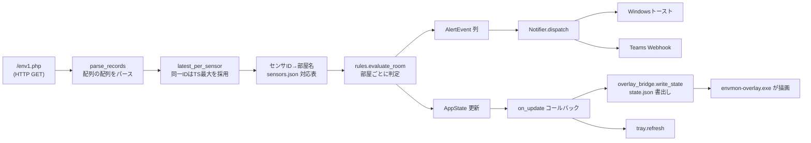

# アーキテクチャ解説（開発者向け）

このドキュメントは **EnvMonitor のコードを読み始める開発者** 向けに、全体像・データフロー・
スレッドモデル・状態管理をまとめたものです。インストールや使い方は
[`README.md`](../README.md)、ビルド・配布は [`BUILD.md`](../BUILD.md) を参照してください。
モジュール単位の責務・主要シンボルは [`MODULES.md`](MODULES.md)、設定HTTPとtbwidgetの
関数レベルの入出力は [`API.md`](API.md) にあります。

---

## 全体像

EnvMonitor は **2 プロセス構成**です。GUI ツールキットに依存しない Python 本体が
「何を表示するか／何を通知するか」を決め、表示は別プロセスの Rust 製オーバーレイに任せます。

| プロセス | 役割 |
|---|---|
| `envmon`（Python・ヘッドレス） | 環境監視・判定・通知・トレイ・設定ダッシュボード(HTTP)。GUI ツールキット非依存。 |
| `envmon-overlay.exe`（Rust・`overlay/`） | タスクバー追従の表示ウィジェット。`state.json` を読んで描くだけで内容は解釈しない。 |

アプリとしての性格：

- **ヘッドレスなトレイ常駐アプリ**。Tk/customtkinter には依存せず、メインスレッドは
  `threading.Event` の待機のみ（`envmon/main.py` の `App.run`）。ユーザーが触れる UI は
  **トレイアイコン**（状態色の変化）・**overlay ウィジェット**（別プロセス）・
  **設定ダッシュボード**（ブラウザで開く HTML）の 3 つ。
- バックグラウンドの `Poller` が `/env1.php` を周期取得し、`rules` で判定、`notifier` で
  2 チャネル（Windowsトースト / Teams）へ通知します。表示側（トレイ色・overlay チップの色）
  も同じ判定結果から導出されます。

---

## 起動シーケンス

```
run_envmon.py
  └─ envmon.main.main()
       ├─ _setup_logging()                 # RotatingFileHandler + stderr
       ├─ SingleInstance().acquire()        # 二重起動を抑止（startup.py）
       └─ App().run()
            ├─ App.__init__()               # 各コンポーネントを生成・結線
            │    ├─ load_config()           # config.json を読み validate.normalize 後 Config を構築
            │    ├─ AppState()              # 実行時の状態モデル
            │    ├─ Notifier()
            │    ├─ Poller(on_update=_on_poll_update)
            │    ├─ OverlayBridge(config)        # Rust オーバーレイの spawn/stop
            │    ├─ ConfigServer(…, _apply_web_config)  # 設定用ローカル HTTP
            │    └─ Tray(on_toggle=_toggle_overlay, on_settings=_open_web_settings, …)
            └─ run()
                 ├─ startup.set_startup(True)   # run_at_startup が真なら HKCU\…\Run へ
                 ├─ poller.start()               # ワーカスレッド開始
                 ├─ overlay.start()              # overlay.exe を spawn（見つかれば）
                 ├─ httpserver.start()           # 設定 HTTP を別スレッドで開始
                 ├─ tray.run_detached()          # pystray を別スレッドで開始
                 └─ self._stop.wait()            # 終了まで待機（GUI メインループ無し）
```

`App` が全コンポーネントのハブです。GUI メインスレッドを持たないため、tray/poller/HTTP の
各スレッドから直接コールバックを呼べます（旧 Tk 版にあった `root.after` マーシャリングは
ヘッドレス化で不要になりました）。

---

## コンポーネント関係

```mermaid
graph TD
    App[App<br/>main.py]
    App --> Config[Config<br/>config.py]
    App --> State[AppState<br/>model.py]
    App --> Notifier[Notifier<br/>notifier.py]
    App --> Poller[Poller<br/>poller.py]
    App --> Tray[Tray<br/>tray.py]
    App --> OverlayBridge[OverlayBridge<br/>overlay_bridge.py]
    App --> ConfigServer[ConfigServer<br/>httpconfig.py]

    Poller --> Config
    Poller --> State
    Poller --> Rules[rules.evaluate_room]
    Poller --> Notifier
    Notifier --> Toast[toast.py]
    Notifier --> Teams[teams.py]

    Tray --> State
    OverlayBridge --> State
    OverlayBridge -->|state.json 書出し / spawn| Overlay[envmon-overlay.exe<br/>overlay/ Rustプロセス]
    ConfigServer --> Validate[validate.normalize]
    ConfigServer -. 配信 .-> HTML[settings.html]

    Tray -. icons.make_icon .-> Icons[icons.py]
```

- `Poller` は唯一の「書き手」で、`AppState` を更新し `Notifier` を呼びます。
- `OverlayBridge` は `AppState` を**読んで** `overlay.state.json`（色解決済みチップ）へ変換する
  だけ。実際の描画は別プロセスの `envmon-overlay.exe` が担い、本体のクラッシュ/再起動とは
  ライフサイクルが分離されています。
- `Tray` は `AppState.worst_severity()` でアイコン色・ツールチップを更新するだけの薄い層です。

---

## データフロー

1 周期の流れ（`Poller._poll_once` → `_update_state`、`envmon/poller.py`）：



ポイント：

- **パース**：`parse_records()` は「配列の配列」JSON を `Reading` 列へ。レコードは
  `[null, "YYYY/MM/DD hh:mm:ss…", センサID, 気温, 湿度, 照度lux, 電圧]`。
  複数書式のタイムスタンプに対応し、`latest_per_sensor()` が同一センサ ID は
  **タイムスタンプ最大の 1 件** を現在値として採用します。
- **センサ→部屋の割り当て**：`sensors.json`（ユーザー専用の権威ファイル）で引きます。
  未割当のセンサは `センサ<ID>` の仮名で扱い、**対応表は書き換えません**。
- **判定**：`rules.evaluate_room()` が部屋ごとに
  (1) センサ停止検知（`stale_minutes` 超過）、(2) 気温・湿度の閾値判定（ヒステリシス付き）、
  (3) 照度ゲート（`off` / `above` / `below`）を評価し、`AlertEvent` 列を返しつつ
  `RoomState.alert_latched` を更新します。**電圧・照度自体は閾値判定の対象外**
  （照度は通知を出すか抑えるかの「ゲート」専用）。
- **通知**：判定はロック内、`Notifier.dispatch()` は **ロック外** で呼びます
  （ネットワーク I/O を伴うため）。`Notifier` がクールダウンと静音時間(Do Not Disturb)を
  集中管理し、`toast` / `teams` へ配信します。
- **表示**：`on_update` は `overlay_bridge.write_state()` を呼び、`AppState` から色解決済みの
  チップ列（部屋名・値・色）を `overlay.state.json` へ原子書き出しします。**色の決定は
  Python の責任**で、overlay はその内容を解釈せず描くだけです。
- **取得失敗時**：HTTP 取得に失敗しても例外でワーカを止めず、`last_poll_error` を記録して
  既存状態のまま停止検知などの評価を続けます。

---

## スレッドモデル

GUI メインループが無いため、実行時は **デーモンスレッドの集合**として動きます。

| スレッド | 担当 | 生成箇所 |
|---|---|---|
| **メインスレッド** | `threading.Event().wait()` で待機するだけ（終了トリガ） | `App.run()` |
| **poller スレッド** | 周期取得・判定・通知・`overlay.state.json` 書出し（daemon） | `Poller.start()` |
| **tray スレッド** | pystray のイベントループ（daemon） | `Tray.run_detached()` |
| **httpconfig スレッド** | 設定ダッシュボードの HTTP（daemon） | `ConfigServer.start()` |

GUI ツールキットが無いため、**マーシャリングの鉄則そのものが不要**になりました
（旧 Tk 版は `root.after(0, …)` でメインスレッドへ渡す必要がありましたが、現行はどの
スレッドからもコールバックを直接呼べます）。並行アクセスからの保護が必要なのは
`AppState.lock`（poller の更新 vs tray/overlay_bridge の読み取り）と `Config` の
アトミック保存（`.tmp`→`os.replace`）だけです。

---

## オーバーレイ連携と設定ダッシュボード

旧 Tk（customtkinter）UI は全廃済みです（`flyout.py` / `widget.py` / `settings_ui.py` は
削除）。**表示は Rust 製タスクバーオーバーレイ**、**設定はブラウザで開く HTML
ダッシュボード**に置き換わっています（経緯・計画は
[`PLAN-headless-rust-overlay.md`](PLAN-headless-rust-overlay.md)）。

**責務分離（言語の壁 = JSON ファイル。1 ファイル 1 書き手でレース回避）：**

- **Python（内容決定）**：poll→判定→色/ラベル解決し、`overlay.state.json` に
  「色解決済みチップ＋visible」を書く（`overlay_bridge.write_state`）。overlay は内容を
  解釈しない。
- **Rust overlay（描画）**：`state.json` を読んでタスクバー左に追従描画するだけ。
  spawn/stop は `OverlayBridge` が担い、`config.overlay.enabled` で起動/停止を追従。
  トレイ「オーバーレイ表示/非表示」は `visible` フラグの書き換えで即時反映されます。
  overlay 本体の実装詳細（追従・透過・ドラッグ等）は
  [`../overlay/README.md`](../overlay/README.md) を参照。

**設定ダッシュボード（`httpconfig.py` + `settings.html`）：**

- tray「設定」→ `webbrowser.open(ConfigServer.url)`。`127.0.0.1` バインド＋起動毎の
  ランダムトークンで保護（トークン無しは 403）。
- 保存は `POST /config` → `validate.normalize()` で**型/範囲フォールバック**してから
  `Config.replace()`→`poll_now()`→`overlay.apply_enabled()`。UI 門番が消えるぶん、
  **不正 JSON の防波堤を `validate.py` に集約**（手編集 `config.json` も `load_config` 時に
  同じ normalize を通す）。
- 全エンドポイント（`/`・`/config`・`/status`・`/test`）のリクエスト/レスポンスJSONの
  正確な形は [`API.md`](API.md) §1 を参照。

---

## 状態管理（`model.py`）

実行時の状態は `AppState` に集約されます。

| 型 | 役割 |
|---|---|
| `Severity`(IntEnum) | `OK / WARN / CRITICAL / STALE`。`color` / `key` / `label` を持ち、トレイ・overlay 配色と状態ラベルの基準。`IntEnum` なので `max(...)` で「最悪の状態」を求められる。 |
| `Reading` | 1 センサの観測値（timestamp / 気温 / 湿度 / 照度 / 電圧）。 |
| `RoomState` | 部屋の現在値・担当センサ ID 群・`alert_latched`（ヒステリシスのラッチ状態）・`last_seen`。 |
| `AppState` | 部屋名→`RoomState` のマップ、`last_poll_ok` / `last_poll_error`、`lock`。`worst_severity()` で全体概況を算出。 |

---

## 設定の単一ソース（`config.py`）

- `Config` はスレッドセーフな設定ホルダ。`DEFAULT_CONFIG` / `DEFAULT_ROOM` を
  `_deep_merge` でユーザー設定に重ね、欠損キーを補います。保存は
  `.tmp` に書いて `os.replace` する **アトミック書込**（`Config._atomic_write`）。
  読み込み・保存の両方で `validate.normalize()` を通し、型/範囲が不正な値は既定へ
  フォールバックします（UI 門番が無い分の防波堤）。
- **保存先の決定**（`app_data_dir()`、優先順）：
  1. 環境変数 `ENVMON_DATA_DIR`
  2. exe と同じフォルダに `config.json` があればそのフォルダ（＝**ポータブル動作**）
  3. どちらも無ければ `%APPDATA%\EnvMonitor`
- **`sensors.json`**（センサ ID→部屋名）は **ユーザー専用の権威ファイル**。アプリは
  読むだけで書き換えません。`Config.reload_sensors()` が **mtime 監視** で外部編集を検知し、
  次ポーリング周期（既定 30 秒以内）で自動反映します。壊れた JSON は無視して直前の
  対応表を維持します。

設定ファイルの形式詳細（全キー・`sensors.json`・`env1.php` レコード形式・Teams ペイロード）は
[`README.md`](../README.md) と [`BUILD.md`](../BUILD.md) を参照してください。
